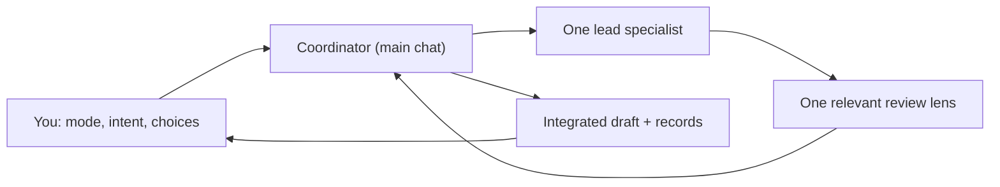

# Working with the narrative agents

The roster is a library of roles. The current chat is the coordinator: it asks you what is needed, picks a lead specialist and one review lens, hands over a bounded task, and integrates the result. The World Director is a responsibility the coordinator performs itself; spawning a director only to forward a prompt wastes a call. A "persistent" specialist is a reusable brief plus the world's saved records, not an agent that keeps running.

## The default flow



1. **Ask the task mode first** (`explore`, `extend`, `edit`, `lock`; `rules/INVENTION.md`), then capture what you want to make, its scale, reference priorities and audience. For a new deliverable, interview before drafting, in facts, function, cost and history, never "picture this". Do not infer the mode and do not assume past your answers: label any remaining assumption as a proposal.
2. **Pick a lead** from `agents/registry.json`, reading only that role and the skill entrypoints it needs. Read `decisions/INBOX.md` and the decisions that affect the pages involved.
3. **Retrieve the smallest sufficient packet**: search `INDEX.md`, open the pages involved, their links and their reverse links (`canon_index.py links-to`). Expand to dependents only when changing something other pages build on.
4. **Draft** into the paths the packet owns. A short task can be done by the coordinator wearing the role. Delegate substantial bounded work to a specialist when the session allows it; the user has asked for economical subagents. Delegation is **one level deep**: the coordinator spawns specialists, specialists do not spawn further agents, and a specialist that needs an answer from you returns the question to the coordinator.
5. **Review with one lens**: Narrative Editor for prose, Canon Custodian for continuity and change impact, Narrative QA Reviewer for player behavior or implementation assumptions. Add a second lens only when risks cross. For a bigger change, **ask the user whether this task needs a reviewer pass**; if yes, run `canon_index.py review-packet` and give `work/review-packet.md` to a read-only Canon Custodian (see its brief). It is off by default and never automatic. A small reversible edit may need only coordinator review; never claim independent review that did not happen.
6. **Integrate and record**: show consequential proposals and open choices together. Write records at the weight the change needs (`rules/INVENTION.md` section 3): nothing for story-local detail, a log line for a small addition, a change record for consequential content, a full record with your words for a protected page. Saving a draft, reviewing it, accepting canon, publishing and changing live state are different actions, and only you accept.
7. **Checkpoint**: phase, artifacts, decisions made, open questions in `decisions/INBOX.md`, next step. On resume read the checkpoint and the changed files, not the whole conversation.

You can answer at any stage. A correction updates the active task; it does not restart finished work. The coordinator reopens only what depends on it.

## Roles, base skills and what a world adds

Each role brief names the reusable base skills and the project additions that matter for its job. A world binds extra skills and context by stable role ID in `.agents/narrative/project.json`, and supplies a reference chain (role cards, category cards, `voice.md`). The coordinator prepares the packet with `py -3 .world-design/library/tools/context.py prepare --project . --role <id>` and verifies it before integrating. See [PROJECT-SKILLS.md](PROJECT-SKILLS.md). Models are pinned per role in the generated adapters and can be overridden per project; they are never part of canon.

## How much context belongs in a packet

Always: the request, mode and allowed change classes, deliverable and length, audience, owned output paths, the decisions to read, protected pages in scope and whether you authorized changing them, required facts with their page names, exclusions and the done criterion. For reference work add the editions and coverage actually accessible and the spoiler ceiling. Put broader indexes in as retrieval pointers, not pasted entities. If a fact is missing, return a labeled proposal or a question; do not start an upstream pipeline. For a canon revision list the claims being superseded and the known reverse dependents. For online behavior say which state is personal, party, regional or shared and who may write it.

## Typical routes

| Request | Lead | Add only when needed | Review |
|---|---|---|---|
| Analyze a book and an adaptation; combine influences | reference-analyst-adapter | a domain owner formalizes the chosen original proposal | canon-custodian for conflicts; editor for a style brief |
| Write a short story | fiction-writer | character-designer for a missing central character | narrative-editor; canon-custodian for consequential additions |
| Describe an unfamiliar city and its history | fiction-writer (description skill) | location-designer or historian for missing facts | narrative-editor |
| Build a port region and a quest chain | location-designer, then quest-narrative-designer | economy-designer for trade; persistent-state-designer for shared consequences | narrative-qa-reviewer |
| Revise a magic rule | magic-fusion | canon-custodian identifies reverse impact; owners revise their pages | relevant rule or continuity review |
| Design a live world event | live-event-designer | persistent-state-designer; onboarding-legacy-designer for late entry | narrative-qa-reviewer |
| Plan a world bible from scratch | coordinator as world-director | one small foundation scope at a time; references before ungrounded synthesis | review each milestone |

The default route is sequential (in interactive Claude Code, subagents may run in the background and in parallel; the coordinator still integrates). Parallelize only independent outputs, each with disjoint paths and the same baseline; only the coordinator integrates shared indexes, decisions and canon changes. A worker that finds a dependency returns it; it never overwrites another worker's draft. For a short story, set the outline and viewpoint first, draft bounded scenes, then review locally and for continuity. For reference work inspect evidence before combining it; an adaptation is not evidence of a novel nobody read.

## Budget and checkpoints

Name the output and the done criterion before every delegation. Prefer one complete bounded draft to a chain of tiny calls, and do not ask every reviewer to reread every file. Before a usage limit or a provider switch save a checkpoint even if work is incomplete, with what was actually verified. A new session continues from it and never treats an incomplete draft as accepted canon.

## Using Claude Code and Codex

The shared definitions generate two native sets: `.claude/agents/*.md` (reviewers get only Read, Grep, Glob, WebFetch, WebSearch) and `.codex/agents/*.toml` (reviewers request a read-only sandbox). Both receive the same contract and role brief. Start the session with the world folder as the project so the entry file (`CLAUDE.md` or `AGENTS.md`, generated identical) and the native definitions are discovered; mentioning a path from a projectless chat loads nothing. The SessionStart hook in `.claude/settings.json` injects the open questions and the ask-the-mode reminder in Claude Code; Codex relies on the entry file, and its sub-agent tool cannot start a role by name (live probe, `docs/PROVIDERS.md`): in Codex the coordinator passes the role brief and skill text (the `context.py prepare` packet) itself. Native names are `narrative-` plus the registry id (`narrative-editor` keeps its name). Provider facts, limits and what is unverified: [../docs/PROVIDERS.md](../docs/PROVIDERS.md).

These files configure Codex and Claude Code. They do not launch one provider from the other and do not become ChatGPT or API agents. To alternate providers, checkpoint a bounded task and give the next coordinator the same packet and paths; never let two coordinators accept changes into the same baseline.

## Maintenance

Edit [contract.md](contract.md), [registry.json](registry.json), [reference-categories.json](reference-categories.json) and [roles/](roles/), then regenerate and check:

```
py -3 tools/sync.py --write
py -3 tools/check.py
```

`check.py` validates the registry and skills, verifies the generated adapters have not drifted, and runs the tests. It needs Python 3.12+ and nothing else. It proves mapping, generation and consistency; it does not prove provider discovery, model performance or engine support.
